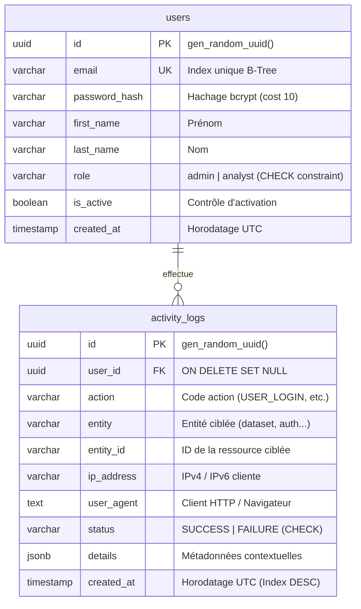

# 🛡️ Architecture & Cybersécurité — Module P1 (Auth, Sécurité & Admin)

*Section rédigée par le Responsable P1 pour le document d'architecture global du projet.*

---

## 1. Rôle dans l'Architecture Globale

Le module **P1** constitue le **socle transversal et sécuritaire** de la plateforme. Aucun des modules métiers (**P2 Datasets**, **P3 Analytics**, **P4 Dashboards**) ne peut fonctionner en production sans s'appuyer sur les services fournis par P1 :
1. **Identification & Authentification (IAM) :** Enregistrement des utilisateurs, vérification des identifiants et émission de jetons cryptographiques sans état (JWT).
2. **Contrôle d'accès basé sur les rôles (RBAC) :** Cloisonnement strict entre Visiteurs (non authentifiés), Data Analysts (utilisateurs réguliers) et Administrateurs.
3. **Traçabilité & Piste d'audit (Audit Trail) :** Journalisation infalsifiable et centralisée de chaque action significative via la fonction `logActivity()`.
4. **Supervision & Espace Administrateur :** Dashboard dédié aux métriques de plateforme, à la gestion du cycle de vie des utilisateurs et à l'inspection des logs d'audit.

### Schéma de l'Architecture Système 3-Tiers

```mermaid
flowchart TD
    subgraph TIER1["Tier 1 : Frontend SPA (React 18 + Vite) - Port 3000"]
        UI_Nav["React Router v6 / AppShell / Navbar"]
        UI_Auth["AuthContext (State JWT & Utilisateur)"]
        UI_Axios["Client Axios Partagé + Intercepteur Bearer Token"]
        subgraph UI_Modules["Vues Métiers & Pages"]
            P1_UI["P1 : Connexion, Inscription, Profil & Console Admin"]
            P2_UI["P2 : Import CSV/JSON, Profilage & Exploration"]
            P3_UI["P3 : Analyseur de Données & Graphiques Recharts"]
            P4_UI["P4 : Éditeur Dashboards, Filtres & Vue Publique"]
        end
        UI_Nav --> UI_Auth
        UI_Auth --> UI_Axios
        UI_Axios --> UI_Modules
    end

    subgraph TIER2["Tier 2 : Backend API REST (Node.js 22 LTS + Express ESM) - Port 5000"]
        MW_Pipeline["Pipeline Middlewares : CORS -> Express.JSON() -> Rate Limiter"]
        MW_Auth["Middleware authenticateToken (P1 : Vérification signature JWT)"]
        MW_Role["Middleware requireRole('admin') (P1 : Contrôle RBAC)"]
        
        subgraph API_Routers["Contrôleurs et Routeurs Express"]
            R_P1["/api/auth & /api/admin (P1)"]
            R_P2["/api/datasets (P2)"]
            R_P3["/api/analytics (P3)"]
            R_P4["/api/dashboards & /api/outliers (P4)"]
            R_Pub["/api/public/dashboards/:token (P4 Public)"]
        end

        Service_Audit["Service d'Audit Fail-Safe : logActivity() (P1)"]
    end

    subgraph TIER3["Tier 3 : Persistance & Données (PostgreSQL 16 Docker) - Port 5435"]
        DB[(PostgreSQL 16 Alpine)]
        Adminer[GUI Adminer Web - Port 8080]
        subgraph Tables["Schéma Relationnel Unifié (8 Tables)"]
            T_P1["P1 : users (UUID), activity_logs (UUID)"]
            T_P2["P2 : datasets, dataset_rows (JSONB)"]
            T_P4["P4 : analyses, analysis_shares, dashboards, dashboard_shares"]
        end
        Tables -.-> DB
        Adminer -.->|Inspection BDD| DB
    end

    UI_Axios ==>|Requêtes HTTP + Bearer JWT| MW_Pipeline
    MW_Pipeline --> MW_Auth
    MW_Auth -->|Session Valide (req.user)| MW_Role
    MW_Role -->|Rôle Analyst / Admin| R_P2 & R_P3 & R_P4
    MW_Role -->|Rôle Admin Requis| R_P1
    MW_Pipeline -->|Accès Public Anonyme| R_Pub

    R_P1 & R_P2 & R_P3 & R_P4 -.->|Journalisation Asynchrone| Service_Audit
    Service_Audit ==>|INSERT activity_logs| DB
    R_P1 & R_P2 & R_P3 & R_P4 & R_Pub ==>|Requêtes SQL Paramétrées ($1, $2)| DB
```

```text
+-----------------------------------------------------------------------------------------+
|                        TIER 1 : FRONT-END (React 18 + Vite SPA)                         |
|   +---------------------------------------------------------------------------------+   |
|   |  React Router v6  ·  AuthContext (JWT State)  ·  Client Axios avec Intercepteur |   |
|   +---------------------------------------------------------------------------------+   |
|       |                       |                      |                     |            |
|  [P1: Auth/Admin]      [P2: Datasets]        [P3: Analytics]        [P4: Dashboards]    |
|  Connexion, Profil,    Upload CSV/JSON,      Moteur requetes,       Editeur widgets,    |
|  Console Supervision   Profilage qualite     Agregations, Recharts  Filtres, Outliers   |
+-------+-----------------------+----------------------+---------------------+------------+
        |                       |                      |                     |
        | HTTP REST + Bearer JWT                       |                     |
        v                       v                      v                     v
+-----------------------------------------------------------------------------------------+
|                     TIER 2 : BACK-END (Node.js 22 LTS + Express ESM)                    |
|  Pipeline Middlewares Securite :                                                        |
|    CORS Filtre  --->  express.json()  --->  authenticateToken (JWT)  --->  requireRole()|
|  -------------------------------------------------------------------------------------  |
|   Modules & Routeurs Metiers :                                                          |
|     • /api/auth & /api/admin   ---> Module P1 (IAM, RBAC, Supervision)                  |
|     • /api/datasets            ---> Module P2 (Ingestion, Detection types, Profilage)   |
|     • /api/analytics           ---> Module P3 (Moteur analytique SQL, Time-bucketing)   |
|     • /api/dashboards,outliers ---> Module P4 (Layouts JSONB, Detection aberrations)    |
|     • /api/public/dashboards   ---> Module P4 (Acces public sans auth + Rate-limit)     |
|  -------------------------------------------------------------------------------------  |
|   Service Transversal d'Audit :                                                         |
|     • logActivity(action, entity, details)  ---> Enregistrement Fail-Safe asynchrone    |
+---------------------------------------+-------------------------------------------------+
                                        |
                                        | Pool PostgreSQL (pg.Pool / Port 5435)
                                        v
+-----------------------------------------------------------------------------------------+
|               TIER 3 : BASE DE DONNEES (PostgreSQL 16 Alpine conteneurise)              |
|   +-------------------------+-------------------------+-----------------------------+   |
|   |       Module P1         |        Module P2        |          Module P4          |   |
|   +-------------------------+-------------------------+-----------------------------+   |
|   | • users (UUID v4)       | • datasets (SERIAL)     | • analyses (JSONB)          |   |
|   | • activity_logs (UUID)  | • dataset_rows (JSONB)  | • analysis_shares (FKs)     |   |
|   |                         |                         | • dashboards (JSONB layout) |   |
|   |                         |                         | • dashboard_shares (FKs)    |   |
|   +-------------------------+-------------------------+-----------------------------+   |
|   Conteneur annexe : Adminer Web GUI (Port 8080)                                        |
+-----------------------------------------------------------------------------------------+
```

---

## 2. Modèle de Données & Schéma Relationnel



### Choix d'ingénierie structurants :
1. **Identifiants UUID v4 (`gen_random_uuid()`) :**  
   Contrairement à des entiers auto-incrémentés (`1, 2, 3`), les UUID empêchent formellement l'énumération de ressources (Insecure Direct Object Reference - IDOR). Un attaquant ne peut pas deviner l'identifiant des autres utilisateurs ou des logs.
2. **Clé étrangère avec `ON DELETE SET NULL` :**  
   Pour des impératifs d'audit et de conformité légale (RGPD/ISO 27001), la suppression d'un utilisateur ne doit jamais détruire la trace des opérations passées. L'événement reste consigné dans `activity_logs` avec `user_id = NULL`.
3. **Validation stricte au niveau de la BDD (`CHECK constraints`) :**  
   Les rôles sont restreints à `CHECK (role IN ('admin', 'analyst'))` et les statuts à `CHECK (status IN ('SUCCESS', 'FAILURE'))`. Même en cas d'anomalie applicative, la base de données protège son intégrité.
4. **Indexation ciblée :**  
   Index B-Tree sur `users(email)` pour garantir un temps de réponse en $O(\log n)$ lors de la connexion, et sur `activity_logs(created_at DESC)` pour alimenter instantanément le dashboard admin.

---

## 3. Matrice de Sécurité & Contrôle d'Accès (RBAC)

| Ressource / Action | Visiteur | Data Analyst | Administrateur |
|---|---|---|---|
| Consulter la page d'accueil (`/`) | ✅ Oui | ✅ Oui | ✅ Oui |
| Créer un compte (`/register`) | ✅ Oui | ❌ (Déjà connecté) | ❌ (Déjà connecté) |
| Se connecter (`/login`) | ✅ Oui | ❌ (Déjà connecté) | ❌ (Déjà connecté) |
| Voir son profil (`/profile`, `/api/auth/me`) | ❌ 401 | ✅ Oui | ✅ Oui |
| Consulter les dashboards publics (P4) | ✅ Oui | ✅ Oui | ✅ Oui |
| Créer / Modifier ses datasets et analyses (P2/P3/P4) | ❌ 401 | ✅ Oui | ✅ Oui |
| Liste des utilisateurs (`/api/admin/users`) | ❌ 401 | ❌ 403 Forbidden | ✅ Oui |
| Promouvoir / Rétrograder un utilisateur (`PATCH /role`) | ❌ 401 | ❌ 403 Forbidden | ✅ Oui |
| Suspendre / Réactiver un compte (`PATCH /status`) | ❌ 401 | ❌ 403 Forbidden | ✅ Oui |
| Consulter les statistiques globales (`/api/admin/stats`) | ❌ 401 | ❌ 403 Forbidden | ✅ Oui |
| Inspecter la piste d'audit (`/api/admin/logs`) | ❌ 401 | ❌ 403 Forbidden | ✅ Oui |

---

## 4. Principes de Cybersécurité Appliqués (Défense en Profondeur)

### 4.1 Protection des Mots de Passe (CWE-256)
- **Hachage adaptatif bcrypt (`saltRounds = 10`) :** Génération automatique d'un sel cryptographique unique par mot de passe.
- **Résistance au Brute-Force :** Le facteur de coût $2^{10} = 1024$ itérations ralentit drastiquement les tentatives d'attaques massives par dictionnaire ou GPU sans pénaliser l'expérience utilisateur légitime (~70ms par vérification).
- **Politique de complexité :** Longueur minimale de 8 caractères imposée dès la validation des formulaires.

### 4.2 Jeton d'Authentification sans état (JWT)
- **Algorithme :** `HS256` signé avec une clé secrète robuste (`JWT_SECRET`).
- **Principe du moindre privilège d'information :** Le payload du token ne contient aucun mot de passe ni donnée sensible, uniquement `{ id, email, role }`.
- **Durée de vie bornée :** Expiration automatique (`24h`) pour limiter l'impact d'un vol de jeton.

### 4.3 Protection Anti-Énumération (OWASP Top 10)
- Lors de l'échec de connexion, l'API renvoie systématiquement un code unifié `INVALID_CREDENTIALS` avec le message générique *"Email ou mot de passe incorrect."*, que l'email soit inexistant ou que le mot de passe soit faux. Un attaquant ne peut pas cartographier la liste des inscrits.

### 4.4 Protection Anti-Injection SQL (CWE-89)
- Toutes les requêtes SQL sans exception utilisent des requêtes paramétrées avec la syntaxe `$1, $2, ...` via le pool `pg`. Aucune concaténation de chaînes de caractères n'est autorisée.

### 4.5 Résilience du Journal d'Audit (Fail-Safe Logging)
- La fonction `logActivity()` est encapsulée dans un bloc `try/catch` isolé. Si l'écriture du log rencontre une difficulté transitoire, l'opération métier principale de l'utilisateur n'est jamais interrompue.

---

## 5. Intégration Front-end (React & Routeur)

1. **Client Axios Partagé (`frontend/src/services/api.js`) :**
   - **Intercepteur de Requête :** Lit le jeton dans `localStorage` et injecte automatiquement l'en-tête standard `Authorization: Bearer <token>`.
   - **Intercepteur de Réponse :** En cas d'expiration (`HTTP 401`), supprime automatiquement les identifiants locaux et redirige l'utilisateur vers `/login`.
2. **Contexte React (`AuthContext`) :**
   - Centralise l'état global (`user`, `token`, `isAuthenticated`, `isAdmin`).
   - Effectue un contrôle automatique de validité du jeton au démarrage via `GET /api/auth/me`.
3. **Garde de Route (`<ProtectedRoute>`) :**
   - Bloque le rendu des composants privés si l'utilisateur est anonyme.
   - Restreint l'accès aux pages réservées aux administrateurs (`requiredRole="admin"`).

