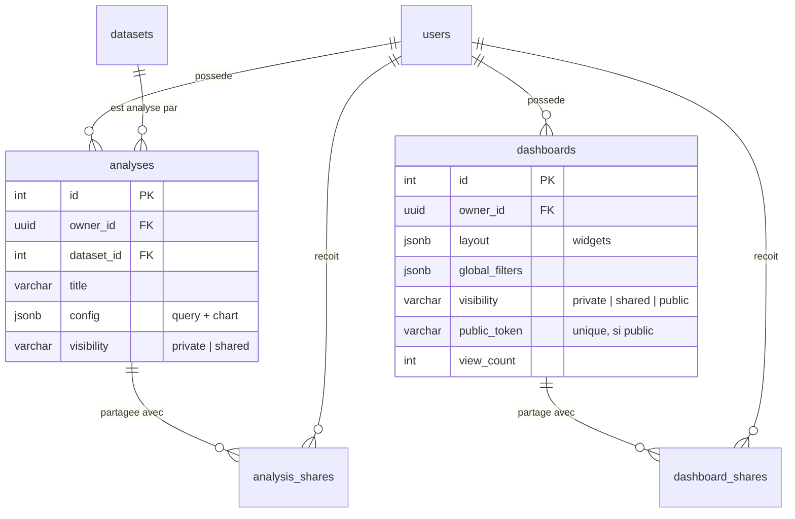
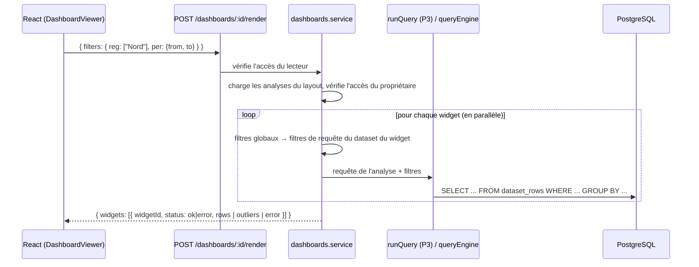

# Dashboards & Partage — architecture

*Section à intégrer au document d'architecture du projet.*

<!-- [FUSION P1/P4] owner_id passé de int à uuid pour suivre la table users de P1 -->

## Rôle dans le cycle de la donnée

Le module couvre les deux dernières étapes du cycle Importation → Exploration → Analyse → **Visualisation → Partage**. Il ne calcule rien lui-même : une analyse enregistrée est une *requête* (dataset, indicateurs, regroupements, filtres) plus un *type de graphique*. Le dashboard est une mise en page de ces analyses, recalculée à chaque affichage, ce qui garantit que les chiffres reflètent toujours les données actuelles.

## Modèle de données



Choix structurants :

- **`config`, `layout` et `global_filters` en JSONB.** Leur forme évolue avec l'interface (nouveaux types de graphiques, nouvelles options) sans migration. La validation est faite côté serveur (`validate.js`) : types autorisés, bornes, 24 widgets et 10 filtres au maximum.
- **Tables de partage séparées** avec clés étrangères et `ON DELETE CASCADE` : supprimer un utilisateur ou une ressource nettoie les partages.
- **Contrainte `CHECK ((visibility = 'public') = (public_token IS NOT NULL))`** : la base elle-même interdit un dashboard privé qui aurait encore un lien public actif.
- Supprimer une analyse retire les widgets qui la référencent, dans tous les dashboards.

## Droits d'accès

| Visibilité | Propriétaire | Admin | Invité (partage) | Autre connecté | Visiteur avec lien |
|---|---|---|---|---|---|
| Privé | Lecture et écriture | Lecture et écriture | Non | Non | Non |
| Partagé | Lecture et écriture | Lecture et écriture | Lecture | Non | Non |
| Public (dashboards) | Lecture et écriture | Lecture et écriture | Lecture | Lecture | Lecture |

Les règles sont centralisées dans une fonction pure (`access.js`), testée unitairement. Trois points méritent d'être soulignés :

1. **Repasser en privé coupe les accès** sans supprimer la liste des invités : la visibilité est vérifiée à chaque requête.
2. **Les widgets sont évalués avec les droits du propriétaire du dashboard**, pas ceux du lecteur. Si l'auteur d'une analyse retire son partage, le widget qui l'utilisait affiche « L'accès à cette analyse a été retiré » au lieu de continuer à exposer les données.
3. Une ressource inaccessible renvoie **404 et non 403**, pour ne pas révéler son existence.

## Calcul d'un dashboard



- Le calcul est fait **côté serveur en un seul appel** : la vue publique n'a ainsi besoin d'aucun accès à l'API d'analyse, et le visiteur ne reçoit que les résultats des widgets (agrégats et, pour le widget d'aberrants, les valeurs signalées), jamais le dataset complet.
- Chaque widget est calculé indépendamment (`Promise.allSettled`) : une analyse en erreur n'empêche pas l'affichage des autres.
- Côté client, le hook `useDashboardRender` attend 300 ms après la dernière modification de filtre et ignore les réponses arrivées dans le désordre.

## Lien public

Le jeton est généré par `crypto.randomBytes(24)` (192 bits, encodé en base64url) : il est impossible à deviner. Il est révocable de deux façons : en régénérant le lien (l'ancien renvoie immédiatement 404) ou en repassant le dashboard en privé. La réponse publique ne contient ni l'e-mail du propriétaire ni le jeton. Les routes publiques sont limitées à 120 requêtes par minute et par IP, et chaque consultation incrémente un compteur de vues visible par le propriétaire et l'admin.

## Sécurité des requêtes

Les lignes des datasets sont stockées en JSONB, donc les noms de colonnes viennent de l'utilisateur. **Les noms de champs comme les valeurs sont passés en paramètres SQL** (`data ->> $3`) : aucune donnée saisie n'est concaténée dans le SQL. Les seuls éléments interpolés (opérateurs d'agrégation, granularité temporelle, sens de tri) sont vérifiés contre une liste fermée. Un test unitaire vérifie qu'un champ nommé `montant'; DROP TABLE users;--` reste un simple paramètre. Les conversions numériques sont protégées par une expression régulière, si bien qu'une cellule non numérique est ignorée au lieu de faire échouer la requête.

## Fonctionnalité avancée : détection des valeurs aberrantes

Trois méthodes, au choix de l'utilisateur :

| Méthode | Règle | Seuil par défaut | Quand l'utiliser |
|---|---|---|---|
| Écart interquartile (IQR) | Hors de [Q1 − k·IQR ; Q3 + k·IQR] | k = 1,5 (Tukey) | Par défaut ; distribution quelconque |
| Z-score | \|x − moyenne\| / écart-type > s | s = 3 | Données à peu près normales |
| Z-score modifié (MAD) | 0,6745·\|x − médiane\| / MAD > s | s = 3,5 (Iglewicz et Hoaglin) | Plusieurs extrêmes présents |

Le z-score classique souffre d'un **effet de masquage** : plusieurs valeurs extrêmes gonflent la moyenne et l'écart-type, et finissent par se cacher elles-mêmes. Un test unitaire le démontre : sur `[20, 21, 19, 22, 20, 21, 500, 520]`, le z-score ne détecte rien alors que la méthode MAD trouve bien les deux valeurs.

L'histogramme renvoyé est **resserré autour de la plage normale** ; les valeurs hors plage sont comptées à part et affichées en repères de bord. Sans cela, un seul montant de 9 800 parmi des montants d'environ 100 écraserait toute la distribution dans une seule barre. Le widget respecte les filtres globaux du dashboard. Le calcul est une fonction pure (`outliers.js`) testée indépendamment de la base.

## Organisation du code

```
modules/dashboards/
  index.js               routes et montage
  controllers.js         couche HTTP (validation → service → réponse)
  analyses.service.js    CRUD et exécution des analyses
  dashboards.service.js  CRUD, visibilité, jeton, calcul, statistiques
  shares.service.js      partage commun aux deux ressources
  access.js              règles de droits (pure)
  validate.js            validation et conversion des filtres globaux (pure)
  outliers.js            détection des valeurs aberrantes (pure)
  queryEngine.js         moteur SQL sur dataset_rows (repli de runQuery)
  deps.js                seul point de contact avec P1, P2 et P3
  sql/                   migration
  tests/                 tests node:test

features/dashboards/
  pages/        liste, éditeur, vue, vue publique, mes analyses, partagés avec moi
  components/   grille, filtres globaux, partage, ajout de widget, aberrants
  hooks/        useDashboardRender
  charts/       adaptateur vers les graphiques de P3
  api/          appels HTTP
```

`deps.js` a permis de développer le module en parallèle des autres : chaque dépendance absente est remplacée automatiquement par un mock, et l'intégration se résume à ajuster des chemins.

## Améliorations envisageables

- Mise en cache des résultats de rendu (par dashboard et par combinaison de filtres), invalidée à la modification d'un dataset.
- Instantanés (*snapshots*) des dashboards publics, pour figer les chiffres d'un rapport.
- Partage par lien avec date d'expiration ; droits d'édition délégués.
- Export PDF ou PNG d'un dashboard.
- Détection d'aberrants multivariée (Isolation Forest) ou sur séries temporelles (écart à une moyenne mobile).
