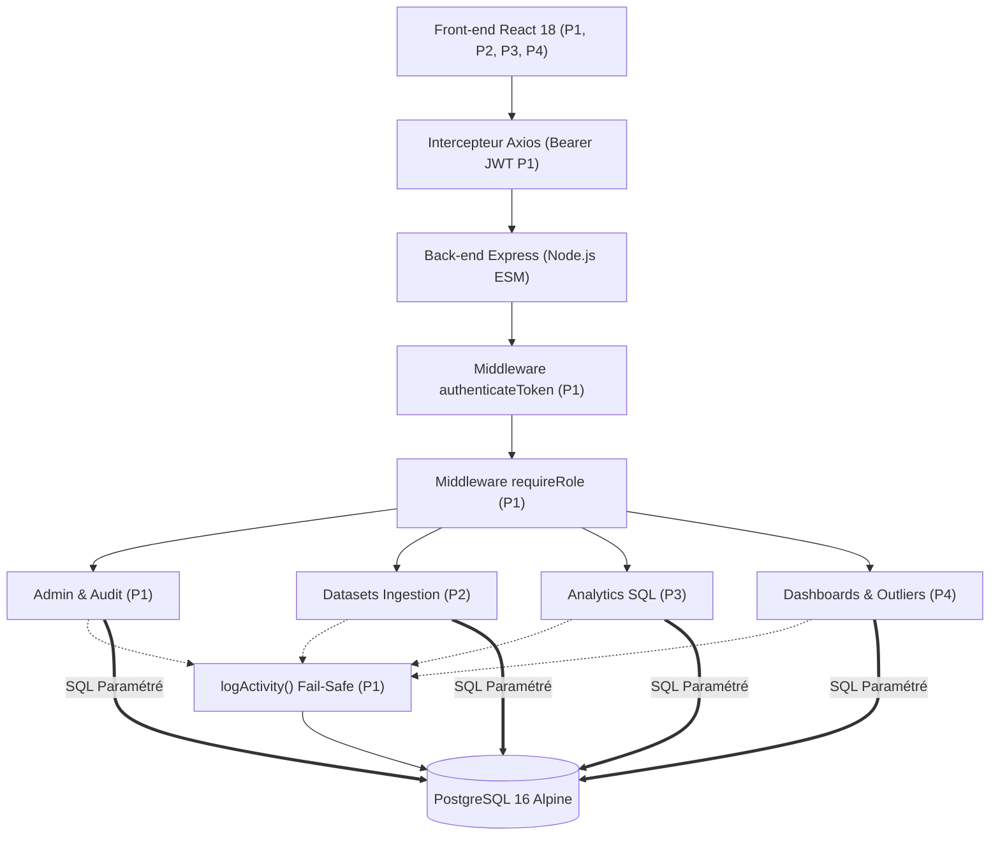

# Rapport de fusion P1, P2 et P4 — Sécurité, données et partage

**Projet :** Plateforme collaborative d’analyse et de visualisation de données
**Périmètre :** socle d’authentification, gestion/exploration des datasets, analyses sauvegardées, dashboards et partage
**Date :** 25 octobre 2026

## 1. Synthèse

Cette fusion décrit trois modules intégrés du MVP. P1 fournit l’identité, les rôles, l’administration et la journalisation. P2 apporte les datasets et leur exploration. P4 permet de sauvegarder des analyses, de les assembler en dashboards interactifs et de les partager. L’architecture sépare le frontend React, l’API REST Express et la base PostgreSQL.

P3 constitue l’étape d’analyse entre l’exploration et la visualisation. Son endpoint et ses composants graphiques sont un point d’intégration de l’équipe ; le moteur SQL de repli de P4 peut exécuter les requêtes sur `dataset_rows` en attendant le service d’analyse final.

## 2. Architecture globale

Le système repose sur une architecture 3-tiers découplée :

Le frontend React utilise React Router pour les pages, `AuthContext` pour la session et le client Axios partagé pour les requêtes. L’intercepteur transmet le JWT. Les pages métier sont protégées par `ProtectedRoute`.

Le backend Express monte les modules sous `/api/auth`, `/api/admin`, `/api/datasets`, `/api/analyses`, `/api/dashboards`, `/api/outliers` et les routes publiques P4. P1 fournit le middleware `authenticateToken`, `requireRole()` et `logActivity()`. Les services métier partagent le pool PostgreSQL.

Le cycle fonctionnel présenté est :

1. l’utilisateur crée un compte ou s’authentifie ;
2. P2 importe et profile le dataset ;
3. P3 définit des indicateurs, filtres et visualisations à partir des lignes ;
4. P4 sauvegarde les analyses, les place dans un dashboard et applique des filtres globaux ;
5. le propriétaire partage le dashboard avec des utilisateurs ou publie un lien révocable.

## 3. Responsabilités des modules

### P1 — Identité, sécurité et administration

P1 gère les utilisateurs avec des UUID, les mots de passe hachés avec bcrypt, les jetons JWT, les rôles `admin` et `analyst`, les pages de connexion/profil et l’espace d’administration. Le journal `activity_logs` conserve les actions importantes. Le middleware et le client Axios de P1 sont les points d’intégration utilisés par les autres modules.

### P2 — Datasets et exploration

P2 gère les métadonnées, l’import CSV/JSON, la détection de types, la lecture paginée, la recherche, les filtres, le tri et le profilage. Les données restent isolées par propriétaire, sous réserve de la supervision administrateur. Les cellules vides sont représentées par `null`, le profil mesure les valeurs manquantes et le score qualité correspond au pourcentage de cellules renseignées.

### P4 — Analyses sauvegardées, dashboards et partage

P4 gère le CRUD des analyses et dashboards, les configurations JSONB, les partages individuels, la visibilité privée/partagée/publique, le rendu avec filtres globaux, les liens publics révocables et la détection des valeurs aberrantes (IQR, Z-score, MAD). P4 conserve son moteur SQL de repli pour interroger `dataset_rows` lorsque le service P3 n’est pas disponible.

## 4. Modèle relationnel intégré

Le socle relationnel comporte huit tables métier :

- `users` et `activity_logs` : identité, rôles et audit (P1) ;
- `datasets` et `dataset_rows` : propriétaire, métadonnées, profil et lignes JSONB (P2) ;
- `analyses` et `analysis_shares` : configuration d’analyse liée au dataset et partage (P4) ;
- `dashboards` et `dashboard_shares` : mise en page de widgets, filtres, visibilité et partage (P4).

Les suppressions utilisent les clés étrangères et les cascades prévues pour nettoyer les lignes et les partages dépendants. Les identifiants utilisateurs restent des UUID conformément à P1 ; les identifiants de datasets sont des entiers conformément au contrat consommé par P4.

Les métadonnées d’un dataset sont relationnelles afin d’être filtrables et rattachées à leur propriétaire. Son schéma de colonnes et son profil sont JSONB. Les lignes sont stockées dans `dataset_rows.data` en JSONB : P3 et P4 peuvent lire une colonne avec son nom, sans migration à chaque nouveau fichier.

## 5. Contrôle d’accès et sécurité

Les routes métier privées vérifient le JWT avec le middleware fourni par P1. P2 vérifie le propriétaire lors des opérations sur les datasets ; les administrateurs disposent de la supervision. P4 applique ses règles de propriétaire, partage et visibilité, et masque l’existence des ressources inaccessibles selon ses contrôles d’accès.

Les valeurs SQL sont paramétrées. Les noms de propriétés JSONB sont également fournis comme paramètres ; les opérateurs de calcul et de tri proviennent de listes autorisées. Les actions métier significatives appellent `logActivity()` sans faire dépendre la réussite de l’opération principale de la disponibilité du journal.

Les pages publiques P4 sont distinctes des pages protégées. Le lien public repose sur un jeton non prédictible et peut être révoqué par republication ou retour à la visibilité privée. Le rendu public expose les résultats des widgets, pas le dataset complet.

## 6. Parcours de démonstration intégré

Le scénario peut être présenté en quatre temps :

1. **Connexion et droits :** ouvrir une session analyste et montrer l’accès protégé aux pages métier ;
2. **Import et exploration :** importer un CSV, afficher la détection des colonnes, la pagination et les valeurs manquantes ;
3. **Analyse et dashboard :** sélectionner le dataset, calculer un indicateur et ajouter l’analyse à un dashboard avec filtre global ;
4. **Partage :** inviter un autre compte puis publier un lien public et montrer sa révocation.

Les jeux seed facilitent le passage de relais : le dataset de ventes contient 204 lignes et des valeurs extrêmes utiles aux visualisations/outliers ; le dataset de qualité contient 12 lignes avec des cellules manquantes pour la démonstration P2.

## 7. Installation et vérification

La procédure opératoire se trouve dans `README.md`. L’initialisation est faite par `npm run db:init`, et le chargement des comptes et données de démonstration par `npm run db:seed` depuis `backend/`. Le seed est conçu pour être relancé sans dupliquer les comptes ni les jeux de démonstration.

Lors de la préparation de cette livraison, le seed PostgreSQL a abouti, le backend P2 a passé `npm run typecheck`, et le parcours applicatif P2 a été validé manuellement. Les tests P4 peuvent être exécutés séparément avec `npm run test:dashboards` depuis `backend/`, et le frontend avec `npm run build` depuis `frontend/`.

## 8. Limites et pistes d’évolution

L’intégration Analytics P3 reste un point d’extension identifié pour le calcul des analyses. Les prochaines évolutions peuvent inclure un import Excel, le nettoyage des valeurs manquantes, le traitement en flux des gros fichiers, l’export, le cache des rendus, l’expiration des liens publics et des droits d’édition délégués.

## 9. Conclusion

P1, P2 et P4 forment les fondations intégrées qui encadrent l’accès aux données, leur préparation, puis leur présentation et leur partage. Les contrats communs — UUID de P1, `user_id` et lignes JSONB de P2, services et droits de P4 — permettent aux modules de fonctionner ensemble sans dupliquer la gestion de session ni la structure des datasets.
